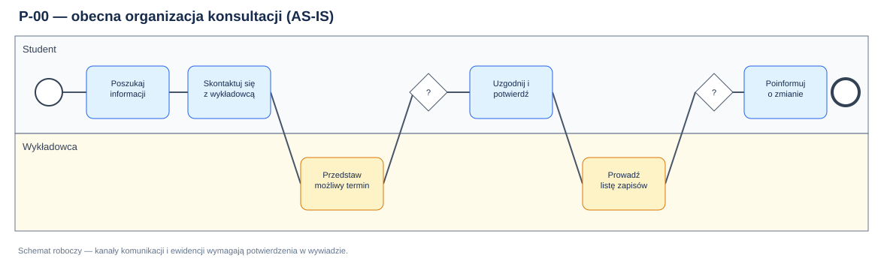

# P-00 — Obecny sposób organizacji konsultacji (AS-IS)

**Wersja:** 0.2 — robocza rekonstrukcja do walidacji  
**Status źródła:** brak rzeczywistego protokołu wywiadu / obserwacji w przekazanych materiałach. Nie traktować jako zatwierdzonego opisu organizacji uczelni.

## Cel i granice procesu

Proces opisuje hipotetyczny przebieg od pojawienia się potrzeby konsultacji po uzgodnienie terminu i ewentualną zmianę lub odwołanie. Granica kończy się na uzgodnieniu albo rezygnacji; sam przebieg spotkania nie jest modelowany.

## Uczestnicy

- **Student** — poszukuje informacji, inicjuje kontakt i uzgadnia termin.
- **Wykładowca** — proponuje dostępność, potwierdza termin i prowadzi listę osób.
- **Kanał komunikacji** — e-mail, komunikator, informacja ustna lub inny kanał; konkretny kanał do potwierdzenia.

## Tabela kroków AS-IS

| Krok | Kto | Czynność | Dokument / narzędzie | Punkt bólu / pytanie | Powiązana potrzeba |
|---|---|---|---|---|---|
| P-00.1 | Student | szuka informacji o dostępnych konsultacjach | strona przedmiotu, ogłoszenie lub informacja ustna — do potwierdzenia | informacja może być rozproszona lub nieaktualna | N-01 |
| P-00.2 | Student | kontaktuje się z wykładowcą, aby ustalić możliwość konsultacji | e-mail, komunikator lub rozmowa — do potwierdzenia | ręczne uzgadnianie wymaga oczekiwania na odpowiedź | N-01, N-02 |
| P-00.3 | Wykładowca | sprawdza własną dostępność i proponuje termin | kalendarz, plan lub pamięć — do potwierdzenia | brak wspólnego widoku aktualnych wolnych miejsc | N-01, N-03 |
| P-00.4 | Student i Wykładowca | uzgadniają i potwierdzają termin | wymiana wiadomości / rozmowa | kilka iteracji kontaktu może wydłużyć proces | N-04 |
| P-00.5 | Wykładowca | zapisuje informację o osobie lub prowadzi listę uczestników | arkusz, lista, skrzynka lub pamięć — do potwierdzenia | ryzyko nieaktualnej listy lub przekroczenia limitu | N-04, N-07 |
| P-00.6 | Student lub Wykładowca | informuje drugą stronę o rezygnacji albo odwołaniu | e-mail / komunikator / rozmowa | informacja o zmianie może nie dotrzeć do wszystkich | N-05, N-06, N-10 |

## Diagram BPMN 2.0 AS-IS (hipoteza do walidacji)

- Źródło edytowalne: [P-00-rezerwacja-as-is.bpmn](P-00-rezerwacja-as-is.bpmn)
- Eksport SVG: [P-00-rezerwacja-as-is.svg](P-00-rezerwacja-as-is.svg)

Diagram przedstawia jedną pulę „Uczelnia” z torami Student i Wykładowca. Czynności są ręczne; e-mail, komunikator, telefon, prywatny kalendarz i lista są wskazane w nazwach czynności jako używane kanały / narzędzia do potwierdzenia. Czerwone obramowanie i etykieta „PUNKT BÓLU” oznaczają miejsca, które SKW może usprawnić. Diagram jest rekonstrukcją do walidacji — nie potwierdzonym wynikiem wywiadu.

## Punkty bólu i odpowiedź w TO-BE

| Punkt bólu (hipoteza) | Odpowiedź w SKW | Proces / wymaganie |
|---|---|---|
| Informacje o terminach rozproszone | jeden widok przyszłych dostępnych terminów | P-01.1, P-01.3 / FR-03, FR-06 |
| Trzeba ręcznie pytać o dostępność | filtrowanie po wykładowcy i dacie | P-01.2–P-01.3 / FR-04, FR-05 |
| Nie wiadomo, czy pozostało miejsce | dostępność i kontrola limitu w chwili zapisu | P-01.3, P-01.8–P-01.9 / FR-03, FR-08, BR-02, BR-10 |
| Lista zapisów jest prowadzona osobno | wykładowca widzi listę zapisów do własnego terminu | P-02.3, P-02.8 / FR-13 |
| Rezygnacja wymaga kontaktu | student anuluje własny zapis w systemie | P-03.1–P-03.6 / FR-10 |
| Odwołanie terminu może nie dotrzeć do studentów | status powiązanych zapisów zostaje zaktualizowany i pokazany | P-02.6–P-02.8 / FR-14, FR-16 |

## Co należy potwierdzić podczas wywiadu

1. Gdzie student znajduje aktualne informacje o konsultacjach?
2. Jakim kanałem odbywa się zapis i co oznacza potwierdzenie?
3. Kto prowadzi listę zapisów i jaki jest limit konsultacji?
4. Czy konsultacje są indywidualne, grupowe, stacjonarne czy zdalne?
5. Jak wyglądają rezygnacje, odwołania i zmiana terminu?
6. Czy istnieją reguły czasu granicznego, kolejka oczekujących lub wyjątki?
7. Jakie dane są potrzebne wykładowcy i studentowi?

**Uwaga:** nie podano średnich czasów ani częstotliwości błędów, ponieważ nie ma danych pomiarowych. Każdy punkt bólu wymaga walidacji.

