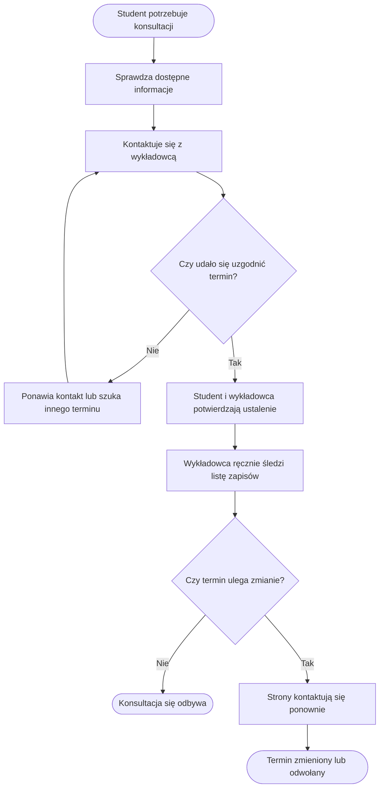

# P-00 — Notatki do procesu AS-IS

**Wersja:** 0.1 — notatki robocze do procesu AS-IS  
**Ważne:** poniższy przebieg nie pochodzi z udokumentowanej obserwacji ani rzeczywistego wywiadu. To robocza rekonstrukcja wynikająca z karty projektu; po rozmowie należy ją poprawić przed narysowaniem BPMN.

## Cel procesu

Opisać, jak student uzgadnia termin konsultacji z wykładowcą w obecnym stanie, zanim zostanie wdrożony SKW.

## Hipotetyczny przebieg do walidacji

| Krok | Kto | Co robi | Dokument / narzędzie | Problem do sprawdzenia | Powiązana potrzeba |
|---|---|---|---|---|---|
| 1 | Student | szuka informacji o terminach konsultacji | strona przedmiotu, wiadomości lub informacja ustna — do potwierdzenia | informacje mogą być rozproszone | N-01 |
| 2 | Student | kontaktuje się z wykładowcą z prośbą o termin | e-mail, komunikator lub rozmowa — zgodnie z kartą projektu | konieczność ręcznego uzgadniania | N-01, N-02 |
| 3 | Wykładowca | proponuje termin lub odpowiada, kiedy ma czas | wiadomość / rozmowa | brak wspólnego aktualnego widoku dostępności | N-01 |
| 4 | Student i wykładowca | potwierdzają ustalony termin | wiadomość / rozmowa | możliwe wielokrotne wiadomości | N-04 |
| 5 | Wykładowca | prowadzi listę zapisanych osób lub pamięta ustalenia | osobna lista / skrzynka / pamięć — wymaga wywiadu | lista może nie być aktualna | N-07 |
| 6 | Student lub wykładowca | informuje o rezygnacji albo odwołaniu | wiadomość / rozmowa | inni uczestnicy mogą nie wiedzieć o zmianie | N-05, N-06, N-10 |

## Schemat roboczy (niezatwierdzony)

## Co trzeba ustalić podczas wywiadu

- Jak student naprawdę znajduje informacje o konsultacjach?
- Kto ma prawo proponować i zatwierdzać termin?
- Czy zapis jest formalnym potwierdzeniem, czy wystarczy wiadomość?
- Kto i gdzie prowadzi listę zapisów?
- Jak przebiega rezygnacja i czy zwolnione miejsce może zająć inny student?
- Jakie są wyjątki: brak odpowiedzi, odwołanie w ostatniej chwili, konsultacja grupowa, nakładające się terminy?
- Ile zwykle trwa każdy etap? Nie wpisywać czasu bez danych od rozmówcy.
