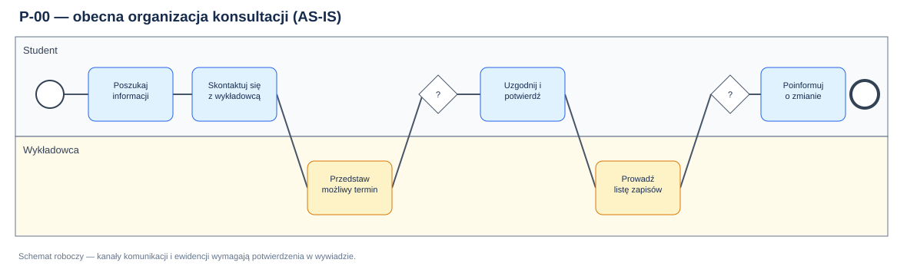

# P-00 — Obecna organizacja konsultacji (AS-IS)

**Wersja:** 0.2 · **Właściciel:** @mtwspa · **Powiązane:** karta projektu, N-01…N-07, N-10

> **Status źródłowy:** rekonstrukcja robocza na podstawie istniejących notatek zespołu. Nie jest to wynik udokumentowanej obserwacji ani rzeczywistego wywiadu. Kanały komunikacji i sposób prowadzenia listy wymagają potwierdzenia.

## Cel procesu

Opisać, w jaki sposób student obecnie uzyskuje informację o konsultacji i uzgadnia termin z wykładowcą przed wdrożeniem SKW.

## Wyzwalacz

Student potrzebuje konsultacji z wykładowcą.

## Uczestnicy

- **Student** — poszukuje informacji i kontaktuje się z wykładowcą.
- **Wykładowca** — odpowiada na prośbę i uzgadnia możliwy termin.
- **Kanały komunikacji / własna lista** — sposób ewidencji do ustalenia w wywiadzie; nie są częścią SKW.

## Wyniki

- termin konsultacji uzgodniony;
- student nie uzgadnia terminu lub rezygnuje;
- termin zostaje później zmieniony albo odwołany — sposób informowania wymaga weryfikacji.

## Diagram

Źródło: [P-00-rezerwacja-as-is.bpmn](P-00-rezerwacja-as-is.bpmn).

## Kroki

| Krok | Rola | Czynność | Dokument / narzędzie | Punkt bólu / powiązanie |
|---|---|---|---|---|
| P-00.1 | Student | Poszukaj informacji o konsultacjach | Strona przedmiotu, wiadomości lub informacja ustna — do potwierdzenia | Informacje mogą być rozproszone (N-01) |
| P-00.2 | Student | Skontaktuj się z wykładowcą | E-mail, komunikator lub rozmowa — do potwierdzenia | Ręczne uzgadnianie terminu (N-01, N-02) |
| P-00.3 | Wykładowca | Przedstaw możliwy termin | Odpowiedź w używanym kanale | Brak wspólnego, aktualnego widoku dostępności (N-01) |
| P-00.4 | Student i wykładowca | Uzgodnij i potwierdź termin | Wiadomość lub rozmowa — do potwierdzenia | Możliwa wielokrotna wymiana wiadomości (N-02) |
| P-00.5 | Wykładowca | Prowadź informację o zapisanych osobach | Lista, skrzynka lub inny sposób — do ustalenia | Aktualność listy wymaga weryfikacji (N-07) |
| P-00.6 | Student | Poinformuj o zmianie lub rezygnacji | Kanał komunikacji do ustalenia | Informacja o zmianie może nie dotrzeć do wszystkich (N-05, N-06, N-10) |

## Wyjątki i ścieżki alternatywne

| Sytuacja | Gdzie | Obecna reakcja | Status |
|---|---|---|---|
| Brak odpowiedzi wykładowcy | P-00.2–P-00.3 | Sposób ponawiania kontaktu nie jest opisany | Pytanie do wywiadu |
| Brak dogodnego terminu | P-00.3–P-00.4 | Dalsze uzgadnianie lub rezygnacja | Hipoteza do walidacji |
| Zmiana lub odwołanie konsultacji | P-00.6 | Kontakt z zainteresowanymi osobami | Hipoteza do walidacji |

## Punkty bólu do sprawdzenia

1. Informacje o konsultacjach mogą być rozproszone.
2. Uzgadnianie terminów może wymagać ręcznej wymiany wiadomości.
3. Wykładowca może prowadzić listę zapisów poza wspólnym systemem.
4. Zmiany i rezygnacje mogą wymagać ponownego kontaktu.

Każdy punkt jest hipotezą wynikającą z notatek zespołu; należy go potwierdzić lub poprawić po wywiadzie.

## Odpowiedź procesów TO-BE na problemy AS-IS

Poniższa tabela pokazuje, gdzie projektowany SKW odpowiada na wskazane problemy. Jest to mapowanie projektowe wynikające z aktualnych procesów P-01–P-03, a nie potwierdzenie, że opis AS-IS został zweryfikowany przez klienta.

| Punkt bólu AS-IS | Odpowiedź w TO-BE | Kroki TO-BE | Powiązane wymagania |
|---|---|---|---|
| Informacje o konsultacjach mogą być rozproszone. | Student przegląda jedną listę przyszłych dostępnych terminów i może otworzyć szczegóły. | P-01.2–P-01.4 | FR-03, FR-04, FR-05, FR-06 |
| Termin jest uzgadniany ręcznie przez wiadomości lub rozmowy. | Student samodzielnie wybiera dostępny termin i zatwierdza zapis w SKW; system sprawdza warunki zapisu. | P-01.5–P-01.8 | FR-07, FR-08, FR-09, FR-17, FR-18; BR-02, BR-03, BR-04 |
| Wykładowca może prowadzić listę zapisów poza wspólnym systemem. | Wykładowca przegląda listę studentów zapisanych na własny termin w SKW. | P-02.7 | FR-13, BR-08 |
| Rezygnacje i odwołania mogą wymagać ponownego kontaktu. | Student anuluje własny zapis w SKW, a wykładowca oddzielnie anuluje własny termin; system aktualizuje statusy. | P-03.2–P-03.7; P-02.8–P-02.10 | FR-10, FR-14, FR-16; BR-06, BR-07 |

## Zakres i kwestie nierozwiązane

- W wersji v1 SKW zastępuje ręczne wyszukiwanie i uzgadnianie terminu w zakresie przeglądania terminów i samodzielnego zapisu.
- Automatyczne powiadomienia e-mail/SMS oraz integracja z systemem planu zajęć pozostają poza zakresem pierwszej wersji.
- Brak odpowiedzi, brak dogodnego terminu i szczegółowy sposób informowania o zmianie wymagają doprecyzowania w wywiadzie; nie przypisujemy im niepotwierdzonych reguł.
- Jeśli wywiad wykaże inny przebieg obecnego procesu, należy zaktualizować P-00 i sprawdzić wpływ na P-01–P-03 oraz `docs/03-wymagania.md`.

## Odniesienia

- [P-01 — przeglądanie i zapis na konsultację](P-01-rezerwacja-konsultacji.md)
- [P-02 — zarządzanie terminami przez wykładowcę](P-02-zarzadzanie-terminami.md)
- [P-03 — anulowanie własnego zapisu przez studenta](P-03-anulowanie-zapisu.md)
- [Rejestr otwartych kwestii](../12-otwarte-kwestie.md)

P-00 opisuje stan obecny i stanowi punkt odniesienia dla procesów docelowych P-01–P-03.
