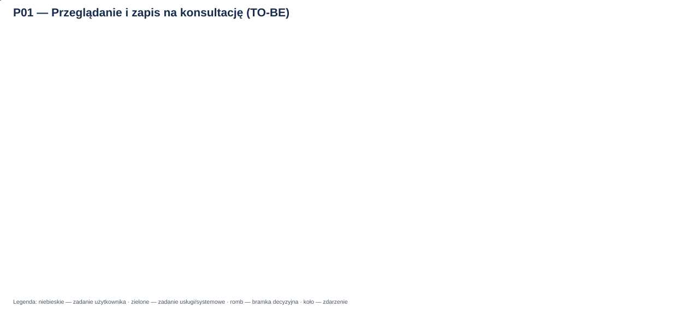

# P-01 — Przeglądanie i zapis na konsultację (TO-BE)

**Wersja:** 0.3 — główny proces TO-BE po walkthrough  
**Właściciel procesu:** Maksym Tymoshenko  
**Pula BPMN:** Uczelnia  
**Tory:** Student, System SKW  
**Cel biznesowy:** doprowadzić od potrzeby konsultacji do potwierdzonego zapisu albo jednoznacznego wyniku odmowy.

## Wyzwalacz i warunki

**Zdarzenie początkowe:** Student potrzebuje konsultacji i rozpoczyna przeglądanie terminów.

**Warunki wstępne:**
- Student posiada aktywne konto i jest zalogowany (FR-01).
- Operacje są wykonywane zgodnie z rolą Student; system ponownie sprawdza uprawnienia przy żądaniach chronionych (FR-02, BR-04).
- W systemie istnieją terminy konsultacji albo lista może być pusta.

## Uczestnicy i odpowiedzialność

| Tor / rola | Odpowiedzialność |
|---|---|
| Student | przegląda terminy, określa filtry, wybiera konsultację i inicjuje zapis |
| System SKW | prezentuje dostępne terminy, waliduje warunki, sprawdza duplikat i limit, zapisuje wynik i informuje o statusie |

Nie ma zewnętrznych pul w tym procesie v1: integracja z uczelnianym SSO, planem zajęć oraz automatyczną pocztą jest poza aktualnym zakresem.

## Wyniki — osobne zdarzenia końcowe

1. **Zapis potwierdzony** — zapis został trwale utworzony i student widzi status Aktywny.
2. **Termin niedostępny** — termin jest przeszły, anulowany lub nie istnieje; zapis nie powstaje.
3. **Duplikat** — student ma już aktywny zapis na ten sam termin; drugi zapis nie powstaje.
4. **Brak miejsca** — w chwili zatwierdzania nie ma wolnego miejsca; zapis nie powstaje.

## Diagram BPMN 2.0

- Źródło edytowalne: [P-01-rezerwacja-konsultacji.bpmn](P-01-rezerwacja-konsultacji.bpmn)
- Eksport SVG: [P-01-rezerwacja-konsultacji.svg](P-01-rezerwacja-konsultacji.svg)

Diagram przedstawia jedną pulę „Uczelnia” z torami Student i System SKW. Sekwencje nie wychodzą poza pulę. Wyjścia wszystkich bramek XOR mają warunki; różne wyniki procesu kończą się osobnymi zdarzeniami końcowymi.

## Kroki procesu i śledzenie wymagań

| Krok | Tor | Typ zadania | Czynność biznesowa | Wymagania / reguły |
|---|---|---|---|---|
| P-01.1 | Student | użytkownika | przegląda dostępne konsultacje | N-01, FR-03 |
| P-01.2 | Student | użytkownika | określa kryteria wyszukiwania: wykładowca i data / zakres dat | N-02, FR-04, FR-05 |
| P-01.3 | System SKW | usługi | wyszukuje i prezentuje przyszłe aktywne terminy z wolnymi miejscami | FR-03, BR-02, BR-06 |
| P-01.4 | Student | użytkownika | wybiera termin i sprawdza szczegóły przed zapisem | N-03, FR-06 |
| P-01.5 | Student | użytkownika | inicjuje zapis na wybrany termin | N-04, FR-07 |
| P-01.6 | System SKW | usługi | sprawdza, czy termin istnieje, jest aktywny i rozpoczyna się w przyszłości | FR-18, BR-01, BR-10 |
| P-01.7 | System SKW | usługi | sprawdza, czy student nie ma już aktywnego zapisu na ten termin | FR-09, BR-03 |
| P-01.8 | System SKW | usługi | atomowo sprawdza dostępność miejsca w chwili zatwierdzania | FR-08, FR-18, BR-02, BR-10 |
| P-01.9 | System SKW | usługi | tworzy zapis i aktualizuje dostępność terminu | FR-07, BR-02, BR-07 |
| P-01.10 | System SKW | usługi | pokazuje studentowi wynik operacji i aktualny status | FR-16, FR-17 |
| P-01.11 | System SKW | usługi — wyjątek | odmawia zapisu, ponieważ termin jest niedostępny | FR-17, FR-18 |
| P-01.12 | System SKW | usługi — wyjątek | odmawia utworzenia drugiego aktywnego zapisu | FR-09, FR-17 |
| P-01.13 | System SKW | usługi — wyjątek | odmawia zapisu z powodu braku wolnego miejsca | FR-08, FR-17, FR-18 |

## Bramki i warunki wyjść

| Bramka | Pytanie | Warunek wyjścia TAK | Warunek wyjścia NIE |
|---|---|---|---|
| G-01 | Czy termin istnieje, jest aktywny i przyszły? | przejdź do P-01.7 | P-01.11 → „Termin niedostępny” |
| G-02 | Czy student ma już aktywny zapis na ten termin? | P-01.12 → „Duplikat” | przejdź do P-01.8 |
| G-03 | Czy w chwili zatwierdzania jest wolne miejsce? | przejdź do P-01.9 | P-01.13 → „Brak miejsca” |

## Wyjątki i ścieżki alternatywne

1. **Termin stał się nieaktualny po wyświetleniu listy.** G-01 = NIE; system nie zapisuje rezerwacji i informuje o niedostępności.
2. **Student ponawia próbę zapisu na ten sam termin.** G-02 = TAK; system nie tworzy duplikatu.
3. **Dwie osoby jednocześnie próbują zająć ostatnie miejsce.** G-03 jest rozstrzygana atomowo; najwyżej jedna transakcja może utworzyć zapis, druga kończy się wynikiem „Brak miejsca”.
4. **Brak wolnych terminów w wynikach wyszukiwania.** System pokazuje pustą listę; student może zmienić kryteria albo zakończyć przeglądanie bez rezerwacji.

## Walkthrough — aktualizacje specyfikacji

- **FR-08** doprecyzowano: kontrola miejsca musi nastąpić atomowo w chwili zatwierdzania zapisu, a nie tylko podczas wcześniejszego wyświetlenia listy (P-01.8).
- **BR-10** dodano: zapis jest możliwy tylko wtedy, gdy termin jest aktywny, przyszły i ma wolne miejsce w chwili zatwierdzania (P-01.6–P-01.8).
- FR-18 pozostaje priorytetem **Should**: walidacje terminu przeszłego/anulowanego i braku miejsca są częściowo współdzielone z FR-03 i FR-08. Wymaganie nadal ma osobne scenariusze negatywne.

## Otwarte kwestie

- Limit miejsc większy niż 1 i konsultacje grupowe — Q-02.
- Nakładające się terminy dla jednego studenta — Q-09.
- Obowiązkowe dane terminu — Q-13.
- Strefa czasowa — Q-10.

