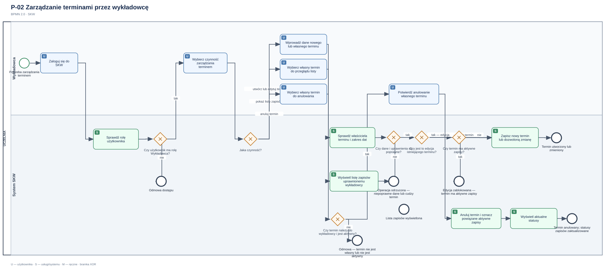

# P-02 — Zarządzanie terminami przez wykładowcę (TO-BE)

**Wersja:** 0.1 · **Właściciel:** @miumeowww · **Issue:** [#6](https://github.com/Grupa-WSPA-3/Projekt/issues/6) · **Powiązane:** FR-02, FR-11…FR-15, FR-16, BR-01, BR-04…BR-06, BR-08, BR-09

## Cel procesu
Umożliwić wykładowcy zarządzanie własnymi terminami konsultacji oraz kontrolę listy zapisanych studentów zgodnie z rolą i regułami systemu.

## Wyzwalacz
Wykładowca chce utworzyć, zmienić, sprawdzić lub anulować termin konsultacji.

## Uczestnicy (tory)
- **Wykładowca** — inicjuje czynności na własnych terminach.
- **System SKW** — weryfikuje rolę i właściciela terminu, sprawdza reguły, zapisuje zmiany oraz prezentuje status.

## Wyniki
- termin utworzony lub poprawnie zmieniony;
- lista zapisów wyświetlona uprawnionemu wykładowcy;
- termin anulowany, a powiązane zapisy otrzymują czytelny status;
- operacja odrzucona z powodu danych, uprawnień lub aktywnych zapisów.

## Diagram BPMN 2.0

Źródło: [P-02-zarzadzanie-terminami.bpmn](P-02-zarzadzanie-terminami.bpmn).

## Kroki

| Krok | Tor | Typ zadania / elementu | Opis | Wymagania |
|---|---|---|---|---|
| P-02.1 | Wykładowca | użytkownika | Zaloguj się do SKW | FR-01 |
| P-02.2 | System SKW | usługi | Sprawdź rolę zalogowanego użytkownika | FR-02, BR-09 |
| P-02.3 | Wykładowca | użytkownika | Wybierz czynność: utworzenie, edycja, przegląd listy lub anulowanie terminu | FR-11…FR-14 |
| P-02.4 | Wykładowca | użytkownika | Wprowadź dane nowego lub edytowanego terminu | FR-11, FR-12 |
| P-02.5 | System SKW | usługi | Sprawdź właściciela terminu i poprawność zakresu dat | FR-02, BR-01, BR-04 |
| P-02.6 | System SKW | bramka XOR / decyzja | Ustal, czy edytowany termin ma aktywne zapisy | FR-12, BR-05 |
| P-02.7 | System SKW | usługi | Zapisz nowy termin lub dozwoloną zmianę | FR-11, FR-12 |
| P-02.8 | Wykładowca | użytkownika | Wybierz własny termin do przeglądu listy zapisów | FR-13, BR-08 |
| P-02.9 | System SKW | usługi | Wyświetl listę zapisów uprawnionemu wykładowcy | FR-13, BR-08 |
| P-02.10 | Wykładowca | użytkownika | Wybierz własny termin do anulowania | FR-14, BR-04 |
| P-02.11 | System SKW | bramka XOR / decyzja | Sprawdź, czy termin należy do wykładowcy i jest aktywny | FR-02, FR-14, BR-04 |
| P-02.12 | Wykładowca | użytkownika | Potwierdź anulowanie własnego terminu | FR-14, BR-04 |
| P-02.13 | System SKW | usługi | Anuluj termin i oznacz powiązane aktywne zapisy | FR-14, FR-16, BR-06 |
| P-02.14 | System SKW | usługi | Wyświetl aktualne statusy terminu i zapisów | FR-16 |
## Wyjątki i ścieżki alternatywne

| Wyjątek | Gdzie | Reakcja | Wymaganie / BR |
|---|---|---|---|
| Użytkownik nie ma roli Wykładowca | P-02.2 | Odmów dostępu do zarządzania terminami | FR-02, BR-09 |
| Wykładowca próbuje zmienić termin innej osoby | P-02.5 | Odrzuć operację bez zmiany danych | FR-02, BR-04 |
| Początek terminu jest w przeszłości lub koniec nie jest późniejszy niż początek | P-02.5 | Odrzuć dane i pokaż przyczynę | BR-01, FR-11, FR-12 |
| Edytowany termin ma aktywne zapisy | P-02.6 | Zablokuj edycję; wykładowca może anulować termin i utworzyć nowy | FR-12, BR-05 |
| Wykładowca wybiera cudzy lub nieaktywny termin do anulowania | P-02.11 | Odrzuć operację bez zmiany danych | FR-02, FR-14, BR-04 |
| Anulowany termin ma aktywne zapisy | P-02.13–P-02.14 | Oznacz powiązane zapisy jako anulowane z powodu anulowania terminu i pokaż status | FR-14, FR-16, BR-06 |

## Powiązanie z AS-IS

P-02 zastępuje część działań wykładowcy z P-00.3 i P-00.5–P-00.6: ręczne przedstawianie możliwego terminu, prowadzenie listy zapisanych osób oraz obsługę zmiany lub odwołania konsultacji. W SKW wykładowca tworzy i zarządza własnymi terminami, przegląda listę zapisów w systemie, a przy anulowaniu terminu system aktualizuje powiązane statusy. Edycja terminu z aktywnymi zapisami jest blokowana zgodnie z FR-12 / BR-05.

## Doprecyzowania z walkthrough

- Odmowa edycji terminu z aktywnymi zapisami powinna zwracać użytkownikowi zrozumiałą przyczynę, a dane terminu pozostają niezmienione (FR-12, BR-05).
- Anulowanie terminu przez wykładowcę musi być odróżnione od anulowania pojedynczego zapisu przez studenta; statusy powiązanych zapisów mają jasno wskazywać przyczynę zmiany (FR-14, FR-16, BR-06).

Są to doprecyzowania wynikające ze spójności procesów i istniejących wymagań; nie stanowią potwierdzenia reguł przez klienta.

## Otwarte pytania
- Czy termin z aktywnymi zapisami może być wyjątkowo edytowany zamiast anulowania? ([Q-04](https://github.com/Grupa-WSPA-3/Projekt/issues/16))
- Czy administrator może przeglądać listy zapisów? ([Q-06](https://github.com/Grupa-WSPA-3/Projekt/issues/17))
- Jak długo przechowywać anulowane terminy i zapisy? ([Q-11](https://github.com/Grupa-WSPA-3/Projekt/issues/20))
