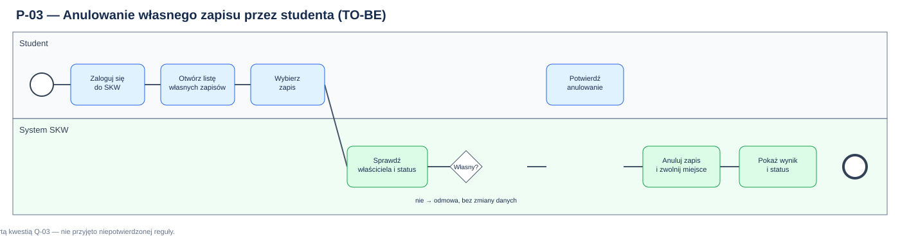

# P-03 — Anulowanie własnego zapisu przez studenta (TO-BE)

**Wersja:** 0.1 · **Właściciel:** @semenukalina89-maker · **Issue:** [#7](https://github.com/Grupa-WSPA-3/Projekt/issues/7) · **Powiązane:** FR-01, FR-02, FR-10, FR-16, BR-04, BR-07, BR-09

## Cel procesu
Umożliwić studentowi rezygnację z własnego aktywnego zapisu oraz zwolnienie zajmowanego miejsca zgodnie z regułami SKW.

## Wyzwalacz
Student nie może uczestniczyć w konsultacji, na którą ma aktywny zapis.

## Uczestnicy (tory)
- **Student** — przegląda własne zapisy, wybiera zapis i potwierdza anulowanie.
- **System SKW** — sprawdza uprawnienia i status zapisu, zmienia status oraz prezentuje wynik.

## Wyniki (zdarzenia końcowe)
- zapis anulowany, miejsce zwolnione;
- operacja odrzucona, zapis pozostaje bez zmian;
- student nie ma aktywnego zapisu do anulowania.

## Diagram BPMN 2.0

Źródło: [P-03-anulowanie-zapisu.bpmn](P-03-anulowanie-zapisu.bpmn).

## Kroki

| Krok | Tor | Typ zadania | Opis | Wymagania |
|---|---|---|---|---|
| P-03.1 | Student | użytkownika | Zaloguj się do SKW | FR-01, FR-02, BR-09 |
| P-03.2 | Student | użytkownika | Otwórz listę własnych zapisów | FR-10, BR-04 |
| P-03.3 | Student | użytkownika | Wybierz zapis, z którego chce zrezygnować | FR-10 |
| P-03.4 | System SKW | usługi | Sprawdź właściciela zapisu i jego aktywny status | FR-02, FR-10, BR-04 |
| P-03.5 | Student | użytkownika | Potwierdź anulowanie własnego zapisu | FR-10 |
| P-03.6 | System SKW | usługi | Zmień status zapisu na anulowany i zwolnij miejsce w limicie | FR-10, FR-16, BR-07 |
| P-03.7 | System SKW | usługi | Wyświetl aktualny status zapisu | FR-16 |

## Wyjątki i ścieżki alternatywne

| Wyjątek | Gdzie | Reakcja | Wymaganie / BR |
|---|---|---|---|
| Student próbuje anulować zapis innej osoby | P-03.4 | Odmów operacji; zapis pozostaje bez zmian | FR-02, BR-04 |
| Zapis jest już anulowany albo nie istnieje | P-03.4 | Nie wykonuj ponownej zmiany; pokaż aktualny status | FR-10, FR-16 |
| Student nie ma uprawnień / sesji | P-03.1 / P-03.4 | Odmów dostępu do operacji | FR-01, FR-02 |
| Student próbuje anulować zapis zbyt późno | przed P-03.5 | Reguła granicznego czasu anulowania nie jest ustalona; nie wprowadzamy jej bez odpowiedzi | pytanie Q-03 |

## Zmiany względem AS-IS
P-03 przenosi anulowanie pojedynczego zapisu do systemu i pozwala zwolnić miejsce bez ręcznego uzgadniania z wykładowcą. Anulowanie całego terminu przez wykładowcę opisuje P-02 i nie jest tym samym zdarzeniem.

## Otwarte pytania
- Do kiedy student może anulować własny zapis? ([Q-03](https://github.com/Grupa-WSPA-3/Projekt/issues/15))
- Czy po anulowaniu miejsce powinno być od razu widoczne jako wolne? Obecne BR-07 zakłada zwolnienie miejsca; szczegóły należy potwierdzić.
