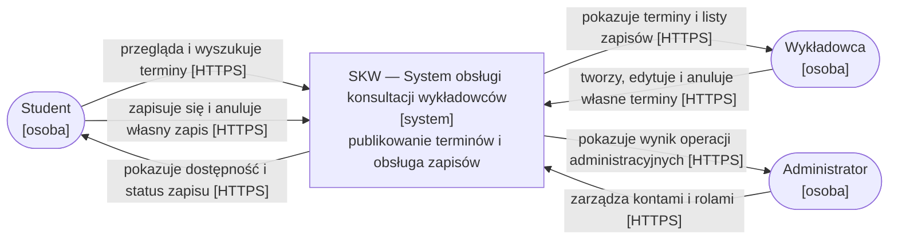

# C4 — poziom 1: kontekst SKW

**Pakiet:** M1 / 0.5 · **Zakres:** pierwsza wersja systemu (v1).

Diagram pokazuje granicę SKW, role i przepływy informacji.

## Tabela elementów

| Element | Typ | Opis / odpowiedzialność | Właściciel |
|---|---|---|---|
| Student | osoba | przegląda terminy, zapisuje się i anuluje własny zapis | użytkownik końcowy; organizacyjny właściciel roli — uczelnia |
| Wykładowca | osoba | zarządza własnymi terminami i listami zapisów | użytkownik końcowy; organizacyjny właściciel roli — uczelnia |
| Administrator | osoba | aktywuje/dezaktywuje konta i przypisuje role | uczelnia; zakres dostępu do list zapisów wymaga potwierdzenia |
| SKW | system | publikuje terminy, obsługuje dostępność, zapisy, anulowanie i uprawnienia | właściciel biznesowy po stronie uczelni — do potwierdzenia |

## Przepływy informacji

| Nadawca | Odbiorca | Informacja / czynność |
|---|---|---|
| Student | SKW | kryteria wyszukiwania, wybrany termin, żądanie zapisu/anulowania |
| SKW | Student | dostępne terminy, szczegóły, wynik operacji, status zapisu |
| Wykładowca | SKW | dane terminu, żądanie utworzenia/edycji/anulowania |
| SKW | Wykładowca | własne terminy, wolne miejsca, lista zapisów |
| Administrator | SKW | aktywacja/dezaktywacja konta, przypisanie roli |
| SKW | Administrator | wynik operacji administracyjnej |

## Systemy zewnętrzne i granica v1

W procesach TO-BE P-01, P-02 i P-03 nie ma potwierdzonej integracji z osobnym systemem zewnętrznym. Dlatego v1 nie pokazuje jako aktywnych integracji SSO, serwera pocztowego, kalendarza ani systemu planu zajęć.

E-mail, komunikator i informacja ustna występują wyłącznie jako możliwe kanały obecnego sposobu uzgadniania konsultacji w P-00. Nie oznacza to, że SKW integruje się z tymi usługami.

Poza zakresem v1 pozostają SSO, automatyczne e-mail/SMS, synchronizacja planu zajęć, wideokonferencje, płatności i natywna aplikacja mobilna. Włączenie integracji wymaga zmiany zakresu IN/OUT, wymagań, ryzyk i ADR.

## Kontrola spójności

- [x] SKW jest jedynym projektowanym systemem.
- [x] Pokazano Student, Wykładowcę i Administratora.
- [x] Relacje opisują czynności i kierunek przepływu.
- [x] Usługi poza v1 nie są przedstawione jako działające integracje.
- [ ] Właściciel biznesowy i organizacyjne zasady ról wymagają potwierdzenia.
