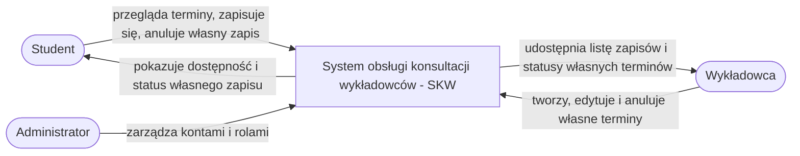

# Diagram kontekstu — SKW

**Wersja:** 0.1 — robocza  
**Źródło:** karta projektu SKW 0.2; role i przepływy do potwierdzenia podczas wywiadu.

Diagram przedstawia system jako jeden element, role zewnętrzne i najważniejsze przepływy informacji.

## Granica systemu

W pierwszej wersji SKW nie integruje się z uczelnianym systemem planu zajęć, zewnętrznym SSO ani serwerem pocztowym. Powiadomienia e-mail/SMS i prowadzenie wideokonferencji pozostają poza zakresem. Jeżeli wywiad wykaże, że któreś z tych połączeń jest konieczne, należy zaktualizować kartę, zakres IN/OUT i ADR, zamiast dodawać integrację po cichu.

## Sprawdzenie diagramu

- [x] system przedstawiony jako jeden element;
- [x] ujęto trzy role z karty projektu;
- [x] każda strzałka opisuje przepływ czasownikiem;
- [x] funkcje poza zakresem nie zostały pokazane jako część SKW;
- [ ] zespół potwierdzi przepływy z klientem;
- [ ] po zatwierdzeniu wymagań zespół zapisze eksport diagramu, jeśli prowadzący będzie go wymagał obok Mermaid.
