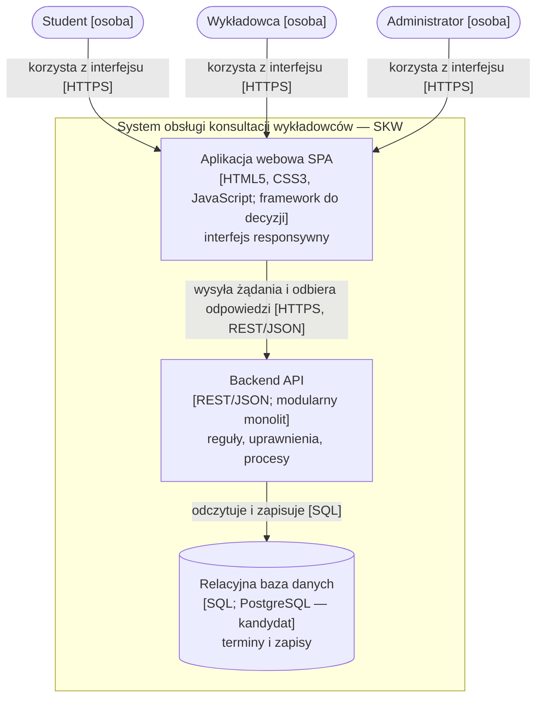

# C4 — poziom 2: kontenery SKW

**Pakiet:** M1 / 0.5 · **Status:** szkic architektury ogólnej. Konkretne frameworki i środowisko wdrożenia pozostają do wyboru w etapie implementacji.

Kontener C4 oznacza osobno uruchamianą / wdrażaną część systemu, np. aplikację webową, backend lub bazę danych. Nie oznacza kontenera Docker. Moduły wewnątrz backendu są komponentami, nie osobnymi kontenerami.

## Tabela kontenerów

## Relacje

| Nadawca | Odbiorca | Czynność i protokół | Uwagi |
|---|---|---|---|
| Przeglądarka | SPA | pobiera i wyświetla aplikację [HTTPS] | funkcje zależne od roli |
| SPA | Backend API | wysyła żądania / odbiera odpowiedzi [HTTPS, REST/JSON] | filtry, dane terminu, zapis i anulowanie |
| Backend API | Baza danych | odczytuje i zapisuje rekordy [SQL] | transakcje i ograniczenia integralności |

Brak potwierdzonych relacji do systemów zewnętrznych w v1. Gdy protokół nie jest znany, wpisujemy „do ustalenia” i dodajemy ryzyko — nie zakładamy integracji.

## Moduły wewnątrz Backend API

To moduły jednego kontenera, nie oddzielne usługi:
1. **Konta i role** — sesja, rola, właściciel zasobu.
2. **Terminy konsultacji** — tworzenie, edycja, anulowanie i walidacja.
3. **Dostępność i zapisy** — limit miejsc, duplikaty, współbieżność.
4. **Administracja** — aktywacja/dezaktywacja kont, przypisanie ról.
5. **Statusy** — wynik zapisu, anulowania i odwołania terminu.

Moduł komunikuje się z innymi przez jawne operacje; nie modyfikuje bezpośrednio tabel innego modułu. Cały backend wdrażany jest razem.

## Wpływ NFR na architekturę

| NFR | Wymaganie | Odpowiedź architektoniczna | Weryfikacja |
|---|---|---|---|
| NFR-01 — przydatność funkcjonalna | 100% historyjek Must przechodzi GWT | każda funkcja Must ma ścieżkę API, regułę BR i test akceptacyjny | lista GWT → UC/FR → test |
| NFR-02 — wydajność | 95% wyszukiwań < 2 s dla 5 000 terminów i 50 użytkowników | filtrowanie w API, indeksy po dacie/statusie/wykładowcy, paginacja | test obciążeniowy |
| NFR-03 — kompatybilność | kluczowe przepływy w dwóch najnowszych stabilnych wersjach Chrome, Firefox i Edge | standardowy frontend webowy, bez API specyficznych dla jednej przeglądarki | macierz testów przeglądarek |
| NFR-04 — interakcja | 4 z 5 testerów kończy zapis w < 3 min bez pomocy | krótki przepływ lista → szczegóły → zatwierdzenie, widoczna dostępność i komunikaty | test użyteczności z pomiarem czasu |
| NFR-05 — niezawodność | 100 prób współbieżnego zapisu nie przekracza limitu | transakcja backendu, ponowne sprawdzenie limitu i ograniczenia integralności bazy | test współbieżności |
| NFR-06 — bezpieczeństwo | 100% testów ról zgodnie z macierzą; odmowa nie zmienia danych | autoryzacja w backendzie przy każdej operacji, kontrola roli i właściciela, domyślna odmowa | testy negatywne trzech ról |
| NFR-07 — utrzymywalność | każda BR ma co najmniej jeden test | moduły odpowiedzialności, wspólne ID BR, testy jednostkowe i integracyjne | macierz BR → moduł → test |
| NFR-08 — elastyczność | czytelny układ bez poziomego przewijania przy 360, 768 i 1366 px | responsywna SPA; aplikacja natywna nie jest wymagana w v1 | kontrola UI w trzech szerokościach |

## Decyzje pozostawione na później

- Framework SPA, język backendu i środowisko wdrożenia nie są ustalone.
- PostgreSQL jest kandydatem na silnik relacyjny — ADR-003.
- SSO, SMTP, plan zajęć, kalendarz zewnętrzny i wideokonferencje są poza v1.
- Ograniczeń UI nie traktujemy jako zabezpieczenia; reguły i uprawnienia egzekwuje backend.
