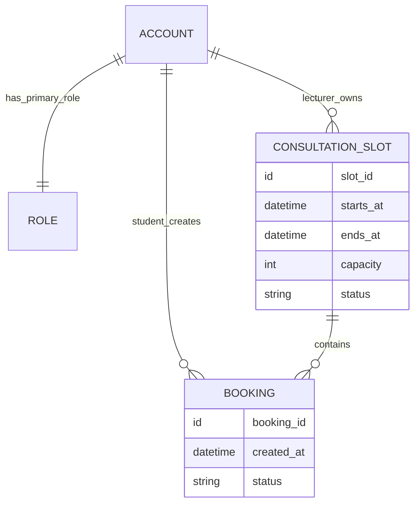

# Model dziedzinowy SKW — szkic pojęciowy

**Status:** szkic wejściowy wynikający ze słownika 0.3 i wymagań 0.2; nie jest zatwierdzonym modelem klas ani schematem bazy danych.

## Główne pojęcia

## Relacje pojęciowe

## Zasady dziedzinowe

- Każdy termin ma jednego wykładowcę-właściciela.
- Każdy zapis dotyczy jednego studenta i jednego terminu.
- Aktywny zapis zajmuje jedno miejsce; anulowany zapis go nie zajmuje.
- Liczba aktywnych zapisów nie przekracza limitu terminu.
- Student nie może anulować zapisu innej osoby.

## Do dopracowania

Potwierdzić liczbę ról na konto (Q-05 / BR-09), dostęp administratora do list zapisów (Q-06), retencję danych historycznych (Q-11) oraz statusy i przejścia terminów i zapisów. Pełny model klas należy przygotować na etapie poświęconym temu zagadnieniu.
