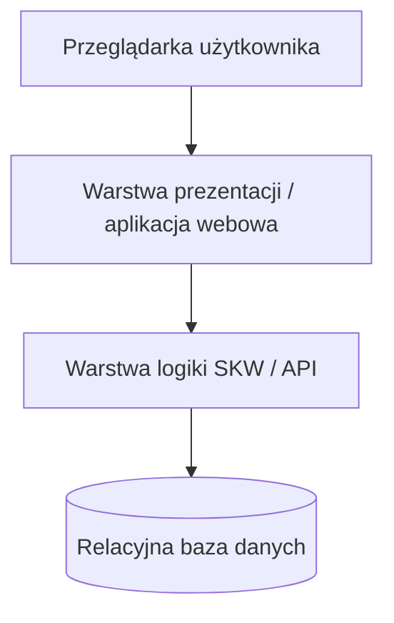

# Model wdrożenia SKW — wariant logiczny

**Status:** wstępna koncepcja; nie wybrano technologii ani dostawcy hostingu. Nie należy traktować jej jako zatwierdzonego modelu infrastruktury.

## Proponowany układ logiczny

## Elementy

| Element | Odpowiedzialność | Uwagi |
|---|---|---|
| Przeglądarka | interakcja ze studentem, wykładowcą i administratorem | responsywny interfejs webowy |
| Warstwa prezentacji | listy terminów, formularze, statusy i komunikaty | nie jest źródłem prawdy o dostępności |
| API / logika SKW | autoryzacja, reguły BR, procesy zapisu / anulowania | ponowna walidacja w momencie operacji |
| Baza danych | przechowywanie kont, terminów i zapisów | transakcje zabezpieczają limit miejsc |

## Zasady bezpieczeństwa i niezawodności

- komunikacja między przeglądarką i serwerem powinna być szyfrowana;
- serwer sprawdza rolę i właściciela zasobu przy każdej chronionej operacji;
- hasła nie mogą być przechowywane w postaci jawnej, jeśli wybrany zostanie lokalny mechanizm logowania;
- rezerwacja ostatniego miejsca wymaga transakcyjnej kontroli współbieżności;
- kopie zapasowe i okres retencji danych wymagają decyzji po Q-11.

## Nierozstrzygnięte

Hosting, system operacyjny, framework, silnik bazy i CI/CD pozostają do decyzji po ocenie make-or-buy i dalszym opracowaniu architektury. Integracje SSO, pocztowe i z planem zajęć są poza v1.
